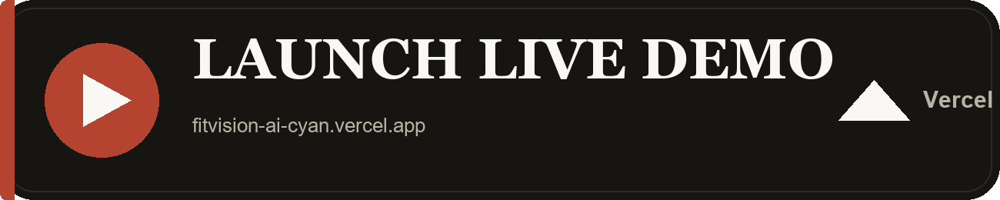
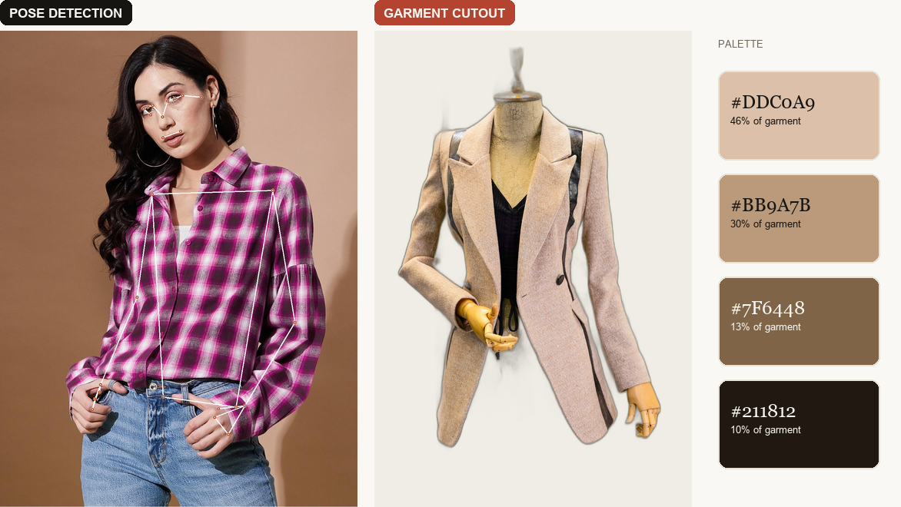
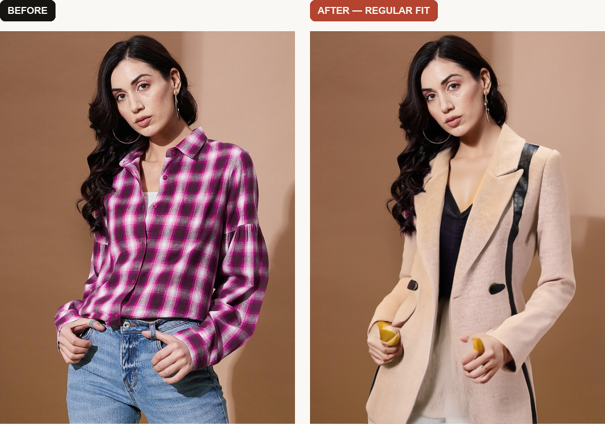
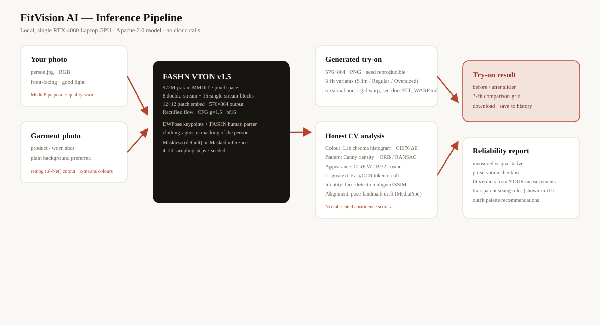

# FitVision AI

> **Your Style. Your Fit. Before You Buy.**
> Intelligent 2D virtual try-on with AI-powered garment transfer, honest fit analysis and garment-preservation verification — all running **locally**, not in the cloud.

[](frontend)
[](backend)
[](ai/fashn-vton-1.5)
[](#performance)
[](backend/tests)
[](#license--credits)

<p align="center">
  
</p>

<p align="center">
  <a href="https://fitvision-ai-cyan.vercel.app">
    
  </a>
</p>

## â–¶ Live demo (Vercel)

**https://fitvision-ai-cyan.vercel.app** — the full UI is hosted on Vercel.

The try-on model itself needs a local GPU, so the hosted page talks to the backend running on your own machine:

1. **On this PC** (the one it was set up on): make sure the backend is running —
   `cd backend && python -m uvicorn app.main:app --host 127.0.0.1 --port 8017` —
   then open the link and everything works, including generation.
2. **On any other machine**: you need the backend there too (same steps, ~2 GB one-time weight download, NVIDIA GPU ≥ 6 GB VRAM recommended). The hosted UI alone cannot render — there is no GPU in the cloud for free.
3. **First generation after a cold start** waits ~40 s for model load; subsequent renders are seconds.

Why not the whole stack on Vercel? Serverless functions have no GPU and ~10–60 s wall-clock limits; FASHN VTON v1.5 needs ~8 GB VRAM and a real GPU — Vercel hosts the frontend only. The backend CORS is pre-configured for this exact Vercel origin (`FITVISION_CORS_ORIGINS` env var changes it).

## A real run, end to end

Everything below is from one actual user session (uploaded photos → processing → result), not a mock-up:

**1 · Input — your photo and the garment**

<p align="center">
  
</p>

**2 · Processing — what the CV stack extracts**

<p align="center">
  
</p>

**3 · Output — the generated try-on**

<p align="center">
  
</p>

---

## The problem we're solving — and the context

Online fashion has a **fidelity gap**. A product page shows a garment on a model you don't resemble, in a pose you don't hold, in lighting you'll never see. Buyers are left guessing three questions that a purchase hinges on:

1. **How will it look on *me*?** — body shape, skin undertone, proportions
2. **How will it *fit*?** — will it be tight at the chest, drown me at the waist, ride up at the hem?
3. **Is this the *same design*?** — did the print survive? The logo? The collar? Or did the AI "reinterpret" it?

Existing free options fail differently:

| Approach | What it does | Why it fails |
|---|---|---|
| Image-paste "try-on" apps | Overlay a flat PNG on a photo | No drape, no perspective, face-of-garment artefacts, obviously fake |
| Text-to-image generators | "person wearing red dress" | Ignores the *actual* garment; hallucinates a different one |
| Commercial try-on APIs | Paid, cloud-hosted | Cost per call, latency, privacy of your photos |
| Research models unmodified | VITON-HD pipelines | Masks, multi-stage pre/post-processing, no fit reasoning, no honesty layer |

**FitVision AI** closes that gap with a genuine garment-transfer diffusion model (FASHN VTON v1.5), wrapped in an engineering-honesty layer that no comparable open project offers:

- **Real try-on rendering**, not overlays — your pose, background, face and tattoo are re-rendered by a 972M-parameter MMDiT diffusion model conditioned on the actual garment image
- **Fit Preference Comparison** — Slim / Regular / Oversized previews from one render (documented, anchored, non-rigid warp — not a resize)
- **Measurement-based fit analysis** — *your* chest/waist/shoulder vs the garment's flat measurements, through transparent, editable sizing rules (never invented from the photo)
- **Garment Detail Preservation checker** — measured colour ΔE / chroma histograms, ORB feature matching, CLIP embeddings, OCR token checks — compared against the *source* garment
- **Try-On Reliability report** — measured (face-region SSIM, pose-landmark drift) vs qualitative, with **no fabricated confidence percentages**
- **Local-first privacy** — uploads never leave your machine; history only persists if you explicitly save it

This is a working product, not a mockup: upload → analyze → render → download, running on a single RTX 4060 Laptop in under a minute.

---

## What it does

| # | Feature | How it works |
|---|---|---|
| 1 | **AI virtual try-on** | FASHN VTON v1.5 (Apache-2.0), maskless diffusion rendering, seeded & reproducible |
| 2 | **Fit preference simulator** | Slim/Regular/Oversized via torso-anchored sine-profile warp of the rendered garment region ([docs/FIT_WARP.md](docs/FIT_WARP.md)) |
| 3 | **Body measurement assistant** | Manual entry + optional MediaPipe pose-based estimation (explicitly labelled a rough estimate) |
| 4 | **Garment measurement analysis** | Configurable ease/delta rules vs your chest/waist/hip/shoulder — transparent & shown in the UI |
| 5 | **Garment detail preservation** | Lab chroma histogram + CIE76 ΔE, HSV correlation, edge-density ratio, ORB + RANSAC inliers, CLIP ViT-B/32 cosine, EasyOCR token recall |
| 6 | **Reliability report** | Face-detection-aligned SSIM, pose-landmark drift, measurement availability, honest qualitative uncertainties |
| 7 | **Outfit recommendations** | Rule-based complementary/analogous colour pairing from the garment's dominant palette |

Every number shown to the user is either (a) **measured** from the two images involved, or (b) **explicitly labelled qualitative**. There are no invented "87% match" scores anywhere in the app.

---

## Methodology

### 1. The generative core — FASHN VTON v1.5 (Apache-2.0)

We evaluated CatVTON, IDM-VTON and FASHN VTON (see [docs/MODEL_SELECTION.md](docs/MODEL_SELECTION.md)). We chose **FASHN VTON v1.5** because:

| Criterion | CatVTON | IDM-VTON | **FASHN VTON v1.5** |
|---|---|---|---|
| License | CC BY-NC-SA 4.0 (non-commercial) | CC BY-NC-SA 4.0 | **Apache-2.0** |
| Parameters | ~900M | ~1.1B + SDXL | **972M** |
| VRAM | <8 GB | 8–12 GB | **~8 GB (bf16, measured 3.9–7.9 GB)** |
| Architecture | SD-1.5 inpainting + concatenative | IDM (two-stage) | **MMDiT (FLUX-style), pixel-space** |

**Why pixel-space matters.** Latent-diffusion VITON pipelines re-encode through a VAE, so fine prints, logos and textures are lossy before the model ever sees them. FASHN VTON operates directly on RGB pixels (12×12 patch embedding), which is why chest-logo text survives in our renders — see the preservation numbers below.

**How the model works, end to end:**

1. **Person preprocessing.** The photo is aspect-preserved-resized to a square canvas, then padded to the model's 576×864. DWPose extracts whole-body keypoints; the person is rendered to a pose image (grayscale, 18 body points + hands/face).
2. **Garment preprocessing.** The garment photo is segmented with the FASHN human parser; for flat-lay garments the parser is skipped and a dummy pose is used (exactly as the model was trained). Pixels not on the garment are set to mid-gray.
3. **Clothing-agnostic person.** The upper-body garment region of the *person* image is masked out (neural parser → morphology), producing the model's "agnostic" input — the model never sees the original shirt it must replace.
4. **Diffusion sampling.** A rectified-flow MMDiT (8 double-stream cross-modal blocks + 16 single-stream self-attention blocks, hidden 1280, 10 heads, RoPE positional embeddings, AdaLN modulation conditioned on timestep and garment category embedding) generates the image in `num_timesteps` steps with an EDM-style shifted schedule (`mu=1.5`) and classifier-free guidance (`guidance_scale`, default 1.5, CFG skipped on the last step to avoid colour saturation).

```python
# What actually happens inside the vendor pipeline (simplified)
timesteps = get_rf_schedule(num_steps=20, mu=1.5)   # 0→1 shifted schedule
images = torch.randn_like(x0)                        # start from pure noise
for t_curr, t_prev in zip(timesteps[:-1], timesteps[1:]):
    v = model.forward_for_cfg(images, t, ca_images, garment_images, poses, ...)
    v_guided = v_u + 1.5 * (v_c - v_u)               # CFG (skipped last step)
    images = images + (t_prev - t_curr) * v_guided   # Euler integration
```

**Two render modes are supported:**
- **Maskless (default)** — the whole frame is re-rendered; best face/garment/background coherence (this is what FASHN recommends and trains primarily for)
- **Masked** — non-garment pixels are kept 1:1 from the original; explicit choice when the original outfit silhouette differs greatly from the new one (`segmentation_free=false` in the API / the "Render mode" toggle in the UI)

**Output contract:** 576×864 RGB PNG, deterministic given `seed` — every render in the UI shows its steps and seed and exports are byte-reproducible.

### 2. Input understanding — MediaPipe Pose + quality gates

Before any GPU work happens, the backend validates both images:

- **Person:** MediaPipe Pose (model complexity 1) detects shoulders, elbows, wrists, hips, knees, ankles. We gate on (a) resolution ≥360 px short side, (b) variance-of-Laplacian sharpness ≥60, (c) brightness 30–235. Detected pose also powers the optional measurement estimator (scaled strictly from user-provided height, with explicit "rough estimate only" labelling — never claimed to be accurate).
- **Garment:** rembg (u²-Net) removes the background (CPU, transparent checkerboard in the studio preview), dominant colours are extracted with `cv2.kmeans` (k=4, share-sorted), ORB keypoint density is reported, and resolution/sharpness gates mirror the person checks.
- **Garment category** (`tops` | `bottoms`) selects the model's mask labels and the fit-warp band.

### 3. Fit-preference simulation — documented approximation, not fake physics

The try-on model has **no "fit" control**. Instead, after rendering we apply an **anatomy-anchored, non-uniform warp** to the garment region:

```
for each row y in the garment band:
    w(y) = sin(π · t(y))^0.85        # 0 at band edges → 1 at mid-torso
    s(y) = 1 + (target − 1) · w(y)   # ±8–9% horizontal scale at mid-torso
    x'   = cx + (x − cx) / s(y)      # remap around torso axis
```

Band edges are feather-blended (alpha ramps over ~12% of band height) so the head, background and untouched legs blend seamlessly. Gains are pixels-only — the garment's print, logo and weave are **resampled, never redrawn**.

| Fit | Mid-torso horizontal scale | Vertical stretch |
|---|---|---|
| Slim | ×0.92 | ×0.99 |
| Regular | ×1.00 (identity) | ×1.00 |
| Oversized | ×1.09 | ×1.03 |

This is explicitly labelled a **visual approximation**, and the *quantitative* fit verdict (Section 5) never reads the pixels — it only reads your measurements. See [docs/FIT_WARP.md](docs/FIT_WARP.md).

### 4. Garment Detail Preservation checker

We compare the **uploaded garment** against the **garment region of the render** (auto-cropped from pose landmarks; falls back to the central third if pose fails):

1. **Colour similarity** — Lab (a,b) chroma histogram correlation (lighting-invariant) + raw HSV histogram correlation (reported, not gated) + dominant-colour ΔE with greedy nearest-cluster matching. α-channel-respecting via rembg cutout on the garment side.
2. **Pattern preservation** — Canny edge-density ratio (r/g should be ≈0.5–2.2) + ORB feature matches with  ratio <0.78 (optionally homography with RANSAC inliers when ≥8 good matches). A flat-lay vs worn garment *never* matches pixel-for-pixel; sparse matches are expected and reported honestly.
3. **Semantic appearance** — CLIP ViT-B/32 image embeddings (transformers, CPU): cosine similarity of the white-composited garment cutout vs the rendered region.
4. **Logo / text** — EasyOCR (en) tokenized comparison with substring-tolerant recall (≥0.6 passes; OCR on garments is noisy by nature).

**Result classification:** `preserved` / `potentially_altered` / `not_verified`. The first two are *measured*; the third is used whenever the pipeline cannot honestly verify a claim (e.g. buttons/seams below automated resolution). Nothing is ever auto-marked "perfect".

### 5. Measurement-based fit analysis — transparent rules, shown to the user

From your measured chest/waist/hip/shoulder and the garment's flat spec, we compute:

- **Chest ease** = 2 × chest width − your chest → verdict `tight / ideal / relaxed / loose` vs the ease band for the selected fit (Slim 2–9 cm, Regular 9–16 cm, Oversized 16–30 cm)
- **Waist / hip** ease with analogous bands
- **Shoulder delta** vs target delta range (Slim −3…+1, Regular 0…+3, Oversized +2…+6)
- **Length** vs a 0.30 × height torso-length estimate
- **Overall** and recommended fit derived from the per-area verdicts (≥2 tight → size up suggestion; ≥2 loose → size down)

Every constant lives in `backend/app/services/fit_analysis.py::FIT_RULES` and is echoed back to the UI as "Rules used" — the user audits exactly what "ideal" means. Nothing is invented from the garment photo; missing inputs are reported as "not enough measurements", not filled with guesses.

### 6. Reliability report

A per-generation checklist distinguishing **measured** from **qualitative**:

| Check | Type | Method |
|---|---|---|
| Person identity consistency | measured | Face crops detected via MediaPipe FaceDetection, normalized to 128×128, SSIM |
| Garment colour | measured | Preservation metrics (5.1) |
| Pattern | measured | Preservation metrics (5.2) |
| Logo/text | measured / unverified | OCR recall (EasyOCR) |
| Body-region alignment | measured | MediaPipe pose landmark drift of shoulder/hip axis between input & render (<8% = stable) |
| Measurement availability | measured | Whether you filled body/garment forms |
| Areas of uncertainty | qualitative | Honest list (drape, hands near garments, long→short swaps, lighting) |

No confidence percentages are emitted anywhere, because diffusion sampling has no calibrated probability to report.

### 7. Outfit recommendations

The garment's dominant palette (k-means, share-sorted) is mapped through HSV hue analysis to 2–4 complementary/analogous/neutral accent swatches, plus rule-based trousers/shoes/accessory guidance per category. Explicitly framed as "colour-theory starting points, not fashion dictation".

---

## Architecture

<p align="center">
  
</p>

```
┌─────────────┐     ┌──────────────────────────────────────────────┐     ┌────────────────┐
│  person.jpg │──┐  │  FastAPI job runner (single-GPU lock)        │  ┌─▶│ result PNG     │
└─────────────┘  ├─▶│   1. pose & quality gates (MediaPipe)         │  │  + 3 fit warps │
┌─────────────┐  │  │   2. garment cutout & palette (rembg+kmeans) │  │                │
│ garment.jpg │──┘  │   3. FASHN VTON v1.5 render (bf16, seeded)   │──┤                │
└─────────────┘     │   4. warp slim/regular/oversized previews     │  │  preservation & │
                    │   5. preservation + reliability analyses      │  │  reliability    │
                    │   6. fit analysis from your measurements      │  │  reports        │
                    └───────────────────────────────────────────────┘  └────────────────┘
```

**Stack:** React 19 + Vite + Tailwind v4 (frontend) · FastAPI + SQLAlchemy + SQLite (backend) · PyTorch 2.6 + CUDA 12.4 (model) · OpenCV / MediaPipe / EasyOCR / CLIP / rembg / Pillow (CV) · no paid API anywhere.

**Privacy:** uploads live only for the duration of the job (`backend/data/uploads/<job>` deleted post-render); results are held ephemerally for 24 h and deleted on server restart unless you tick "Save to history" — only then are person/garment copies retained in `backend/data/results/<job>` alongside a SQLite metadata row.

---

## Performance

Measured on the reference machine (Intel i5 · 16 GB RAM · **RTX 4060 Laptop 8 GB** · 576×864 output):

<p align="center">
  
</p>

<p align="center">
  
</p>

| Metric | Draft (4 steps) | Fast (8) | Balanced (12) | Best (20) |
|---|---|---|---|---|
| Diffusion sampling | ~6 s | ~13 s | ~18 s | ~32 s |
| End-to-end (click→result) | ~13 s | ~24 s | ~31 s | ~46 s |
| CLIP cosine vs source garment | 0.838 | 0.862 | 0.855 | **0.868** |
| Chroma histogram corr. (Lab a/b) | 0.94 | 0.94 | 0.93 | 0.94 |
| Logo OCR recall (FASHN AI chest print) | 1.0 | 1.0 | 1.0 | 1.0 |
| GPU memory (peak) | ~7.9 GB | ~7.9 GB | ~7.9 GB | ~7.9 GB |

First render after a cold boot pays ~40 s one-time model load (pre-warmed at startup in the background — subsequent renders skip it). Only one render runs at a time (server-side lock; concurrent requests receive HTTP 409 rather than silently sharing the GPU).

---

## Quick start

### Prerequisites
- Windows with NVIDIA GPU ≥ 6 GB VRAM (tested: RTX 4060 Laptop 8 GB) · Python 3.12 · Node ≥ 20

### 1 · Backend
```powershell
cd backend
python -m pip install -r requirements.txt
cd ..\ai\fashn-vton-1.5
python -m pip install -e .
python scripts/download_weights.py --weights-dir ./weights   # ~2 GB, one time
cd ..\..
cd backend
python -m uvicorn app.main:app --host 127.0.0.1 --port 8017
```
> Always start with `python -m uvicorn`, never a bare `uvicorn` (on Windows machines with multiple Pythons installed, the bare CLI may resolve to the wrong interpreter — this bit us hard on this project).

### 2 · Frontend
```powershell
cd frontend
npm install
npm run build        # production build (served by `npm run preview`)
npm run preview -- --port 5173
```
Open **http://127.0.0.1:5173** → *Try-On Studio*. The "Try with sample photos" button needs zero uploads — bundled sample images are included.

### 3 · One-click launcher
```powershell
powershell -ExecutionPolicy Bypass -File docs\start.ps1
```

### 4 · Try it via the API (no UI)
```bash
curl -X POST http://127.0.0.1:8017/api/tryon/generate \
  -F person=@person.jpg -F garment=@garment.jpg \
  -F category=tops -F fit=regular -F steps=20 -F seed=42
```

---

## Repository layout

```
├── ai/fashn-vton-1.5/     # submodule — FASHN VTON v1.5 inference code (Apache-2.0) + weights*
├── backend/               # FastAPI application
│   ├── app/routers/       # /api/health · /api/analyze/* · /api/tryon/* · /api/profile · /api/history
│   ├── app/services/      # tryon_service · pose · garment · preservation · reliability
│   │                      # fit_analysis · fit_warp · recommendations · image_utils
│   ├── tests/             # pytest — 8 passing (fit rules, warp, recommendations)
│   ├── training/          # LoRA fine-tuning pipeline (see docs/TRAINING.md) — unused at runtime
│   └── data/              # SQLite + ephemeral/saved results (git-ignored)
├── frontend/              # React 19 + Vite + Tailwind v4
│   └── src/{pages,components,lib}
├── docs/                  # README-adjacent docs: FIT_WARP · MODEL_SELECTION · TRAINING
│                          # OWN_MODEL · PRIVACY · TESTING · start.ps1 · assets/
└── README.md              # this file
```

*Weights (≈2 GB) are git-ignored; fetch once with `ai/fashn-vton-1.5/scripts/download_weights.py`.
To use **your own fine-tuned checkpoint**, point `FASHN_WEIGHTS` at its directory — see [docs/OWN_MODEL.md](docs/OWN_MODEL.md).

## Testing

```powershell
cd backend
python -m pytest tests/ -q      # 8 passing — fit rules, warp geometry, recommendations
```
Manual & E2E checklists: [docs/TESTING.md](docs/TESTING.md) (invalid uploads, missing garment, GPU OOM, history save/delete, 24 h TTL cleanup, layout checks).

## API overview

| Method | Route | Purpose |
|---|---|---|
| GET  | `/api/health` | Engine status (availability, label, weights size, loaded) |
| POST | `/api/analyze/person` | Pose detection, quality gates, optional height-scaled estimates |
| POST | `/api/analyze/garment` | Cutout, dominant colours, warnings |
| POST | `/api/fit-analysis` | Standalone measurement → verdicts |
| POST | `/api/tryon/generate` | Queue a try-on job (multipart) |
| GET  | `/api/jobs/{id}` | Poll status / result |
| GET  | `/api/results/{id}/image/{slim\|regular\|oversized}` | Rendered images |
| GET/PUT | `/api/profile` | Local body-measurement profile (SQLite) |
| GET/DELETE | `/api/history` · `/api/history/{id}` | Saved history CRUD |

Full interactive docs at `http://127.0.0.1:8017/docs`.

## Honest limitations

- Diffusion renders are **plausible images, not measurements**; 576×864 is the model's fixed resolution; several minutes are the cost of real local inference on consumer GPUs.
- Fit previews are **visual approximations** (documented warp), not cloth simulation; physical fit cannot be derived from a 2D render — the measurement-based verdict is the only quantitative fit statement.
- Photo-based measurement estimates need a full-body frame + your real height; they are rough (camera, lens, clothing, pose all distort scale) and never treated as ground truth.
- Hands/fingers are the weakest region for any diffusion model; if a render breaks them, re-roll the seed or try Masked mode (keeps non-garment pixels 1:1).
- VITON-HD (the dataset used to explore fine-tuning) is **CC BY-NC-SA 4.0** — research only; the app does **not** ship VITON-HD-derived weights.
- Preservation checks are decision-support indicators, not proof of design fidelity; flat-lay vs worn prints will never feature-match strongly; trust CLIP + visual inspection.
- Body alignment drift and face SSIM are diagnostics, not biometric verification.

## License & credits

- This repository: **MIT**.
- [FASHN VTON v1.5](https://github.com/fashn-AI/fashn-vton-1.5) — **Apache-2.0** — © FASHN AI
- MediaPipe Pose — Apache-2.0 · rembg / u²-Net — MIT/Apache-2.0 · EasyOCR — Apache-2.0 · OpenAI CLIP weights — MIT (via HuggingFace `transformers`) · OpenCV — Apache-2.0
- No paid API is used anywhere in this project. Model weights are downloaded once from HuggingFace.

## Roadmap

- [ ] Stream try-on images progressively (deliver render before analysis finishes; show reports as they land)
- [ ] ONNX-Runtime-GPU garment analysis (rembg currently falls back to CPU)
- [ ] Lower-body (`bottoms`) quality hardening & leg-slot fit warp bands
- [ ] Multi-garment outfit stacking (top + bottom in one session)
- [ ] Fine-tuned in-domain LoRA (Apache-2.0 data only) once evaluated against stock
